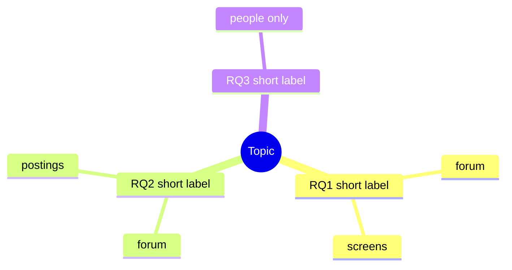

# Shape the question (optional)

Arguments: $ARGUMENTS

This step is optional and always skippable. `research-studio:new` offers it and moves on at once if
the user already has questions. It can also be used mid-study when a question needs reworking.

Load `research-studio:study-synthesis` (the method) first, and keep its purpose in mind: the studio
does **proxy research** for when testing with people isn't possible. Forum findings, job postings and
on-screen review stand in for what people do, so a good question is one that proxy evidence can
speak to, and it says plainly where it can't.

## How we work: in sync, yes or no

The user's thinking comes first and the user owns the taste. Claude helps by **suggesting**, never by
deciding.

- Ask one prompt at a time. Offer two or three candidate answers or follow-up questions the user
  could say yes or no to ("Is it closer to A or B?"), plus room to answer in their own words.
- Wording is proposed only after the user has said what they mean, and is marked **Proposed** until
  they say yes. Never write a Goal or research question as settled without a yes.
- The user can say "skip" to any prompt, "enough" to stop, or "go with that" to accept a proposal.
  Skipped prompts are noted as skipped, not filled in.

## Entry: pick the depth (one line)

Ask, with these as the options:
1. **I have my questions:** stop here and hand back to `new`. Nothing is written.
2. **I have a topic:** quick pass, prompts 1, 3, 4 and 5.
3. **I have a hunch or a frustration:** the full pass, prompts 1 to 6.

## The prompts

1. **The decision.** What decision, design or piece of work will this inform? (Suggest likely
   candidates from what the user has said.) A study with no decision behind it tends to produce
   findings nobody uses.
2. **The people and the moment.** Who is in the situation, and what are they trying to do at that
   moment? Offer a one-sentence version for a yes or no.
3. **What you believe going in.** Beliefs are written before any findings so the synthesis can check
   them. If there are none, confirm it as a **discovery study** (the user's call).
4. **Can proxy evidence answer it?** For each candidate question, name which source types could
   speak to it (forum findings, job postings, on-screen review, first-click predictions) and which
   can't. Anything that needs people to answer it goes in "Only tests with people can settle this",
   which is a note, not a failure.
5. **Narrow it.** Check each question against:
   - one distinct thing per question
   - "how" or "what", not "is X good"
   - not leading, and no solution hidden in the wording
   - answerable from what is observable, or from what people say in public
   Suggest a tightened version of any question that fails, as a yes or no.
6. **Out of scope.** What are we deliberately not asking this time?

## What it produces

Write these as **Proposed** (the user's yes makes them settled), in the question trail:

- **Goal** (one sentence) and **1 to 4 research questions** (RQ1…).
- **Beliefs** or "none stated: this is a discovery study".
- **Out of scope.**
- **Evidence plan:** a small table, one row per RQ: source types that can speak to it, and what only
  tests with people could settle.
- **The trail:** each version of the question (v1, v2, v3…) with one line on why it changed, newest
  last. This is the "thread". Keep earlier versions; don't overwrite.
- **A mind-map outline:** the topic, the sub-questions under it, and the evidence source for each
  branch. See the Mermaid shape below.

### Mind map (light version)

Write it as an indented outline in `question.md`, and as a Mermaid block in Notion (Notion renders
Mermaid in a code block with the language set to `mermaid`).

Later, if it earns its place: link each finding (F1, FF3) back to its branch so the map shows which
questions have evidence and which are bare. An interactive map in a design tool is out of scope for
now.

## Where it lives

- **Local:** `~/Documents/studies/<ST-n>/question.md` (the source), written once a study folder
  exists. Before that, keep it in the conversation and hand it to `new`.
- **Notion:** a "Question trail" toggle at the top of the study page's Brief, holding the trail, the
  evidence plan and the Mermaid block. No template change is needed for this.
- The Goal and RQs also go in the study's properties, as `new` already does.

## Hand-off

Give `research-studio:new` the Goal, RQs, beliefs, out of scope and evidence plan, so that step 2 of
`new` ("draft Goal and RQs you can propose") is skipped. If the study already exists, update the
Brief and properties with the user's yes, and note the change as a new version in the trail.

A worked example (ST-5, written after the fact) is in `${CLAUDE_PLUGIN_ROOT}/skills/question/example-st5.md`.
